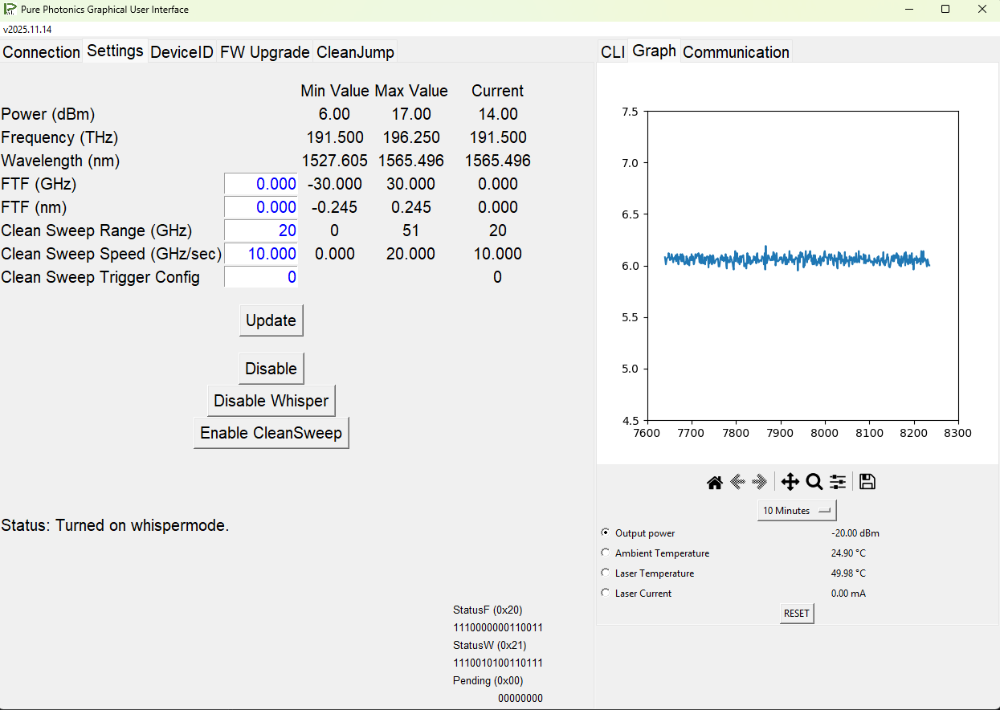

# Pure Photonics PPCL550 laser data

These values were recorded on 2026-11-15 from the Settings and Graph tabs of the Pure Photonics
Graphical User Interface (version v2025.11.14).

## Settings (Settings tab)

| Parameter | Min | Max | Current |
|---|---|---|---|
| Power (dBm) | 6.00 | 17.00 | 14.00 |
| Frequency (THz) | 191.500 | 196.250 | 191.500 |
| Wavelength (nm) | 1527.605 | 1565.496 | 1565.496 |
| FTF, fine tune (GHz) | -30.000 | 30.000 | 0.000 |
| FTF, fine tune (nm) | -0.245 | 0.245 | 0.000 |
| Clean Sweep Range (GHz) | 0 | 51 | 20 |
| Clean Sweep Speed (GHz/sec) | 0.000 | 20.000 | 10.000 |
| Clean Sweep Trigger Config | | | 0 |

The values are consistent with each other: 191.500 THz is 1565.496 nm and 196.250 THz is
1527.605 nm. The ±30 GHz FTF range is ±0.245 nm at this wavelength.

## Laser state

- The laser is on (the button offers Disable).
- **Whisper mode is on.** The status line reads "Turned on whispermode." and the button offers
  Disable Whisper. This is the laser's low-noise mode, with the frequency dither turned off.
- CleanSweep is off (the button offers Enable CleanSweep).

## Monitoring (Graph tab)

| Reading | Value |
|---|---|
| Output power (readout next to the graph) | -20.00 dBm |
| Output power (graph, 10-minute window) | steady at about 6.0 to 6.1 dBm |
| Ambient Temperature | 24.90 °C |
| Laser Temperature | 49.98 °C |
| Laser Current | 0.00 mA |

## Status registers

| Register | Value |
|---|---|
| StatusF (0x20) | 1110000000110011 |
| StatusW (0x21) | 1110010100110111 |
| Pending (0x00) | 00000000 |

## Notes

- **The power readings disagree.** The setpoint is 14 dBm and the graph shows about 6 dBm, but
  the readout next to the graph is -20 dBm with a laser current of 0 mA. Find out which reading
  is correct before relying on the monitor values.
- **5 km measurements on 2026-11-15.** At 6 dBm the linewidth came out at 51.4 kHz. At 12 to
  16 dBm it came out at 15.5 to 18 kHz. The difference may come from Whisper mode being turned on,
  not from the power itself. Record whether Whisper is on or off in the note of every measurement
  (`--note`).
